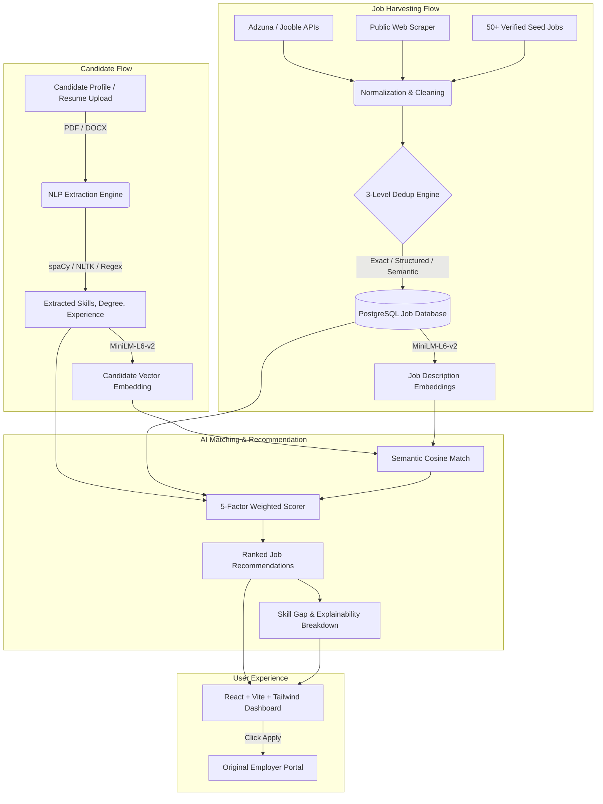

# JobPilot AI – Unified AI Job Discovery & Application Assistant

[](https://fastapi.tiangolo.com/)
[](https://python.org)
[](https://react.dev)
[](https://tailwindcss.com)
[](https://www.sbert.net/)
[](https://www.postgresql.org/)

**JobPilot AI** is a production-quality, full-stack academic project built for MCA/M.Tech final year evaluations. It bridges the gap between candidates and job openings through **NLP-driven resume extraction, multi-source job harvesting, multi-tier deduplication, transparent 5-factor matching algorithms, and automated skill gap roadmaps**.

---

## 🚀 Key Features

1. **Intelligent Resume NLP Extraction**:
   - Parses both **PDF** (PyMuPDF) and **DOCX** (python-docx) files.
   - Extracts candidate contact info, degrees, graduation years, and work duration.
   - Recognizes **700+ technical skills** categorized across languages, web, AI/ML, databases, and cloud with alias canonicalization (e.g. *k8s* → *Kubernetes*, *py* → *Python*).

2. **Transparent 5-Factor Weighted Matching Engine**:
   - **No hardcoded random numbers or fake AI scores**.
   - Formula:
     $$\text{Score} = (0.35 \times \text{SkillMatch}) + (0.30 \times \text{SemanticSim}) + (0.15 \times \text{ExperienceFit}) + (0.10 \times \text{EducationFit}) + (0.10 \times \text{PreferenceFit})$$
   - Computes deep cosine similarity using `sentence-transformers/all-MiniLM-L6-v2`.

3. **Multi-Source Job Acquisition**:
   - **Authorized APIs**: Integrations with Adzuna and Jooble.
   - **Public Web Scraper**: Rate-limited, robots.txt-respecting BeautifulSoup scraper.
   - **Realistic Seed Data**: 50+ curated Indian tech roles across Bengaluru, Hyderabad, Pune, Mumbai, and Remote.

4. **3-Level Deduplication Engine**:
   - **Level 1 (Exact)**: Canonical URL tracking-parameter stripping and unique external IDs.
   - **Level 2 (Structured)**: Normalized company + sanitized title + location composite hashing.
   - **Level 3 (Semantic)**: Cosine vector similarity thresholding ($\ge 0.85$) across job descriptions.

5. **Actionable Skill Gap Analysis**:
   - Categorizes skills for each role into:
     - 🟢 **Matching Skills**
     - 🟡 **Partial / Transferable Skills** (e.g., React $\leftrightarrow$ Vue.js, MySQL $\leftrightarrow$ PostgreSQL)
     - 🔴 **Missing Skills**
   - Suggests structured learning priorities to reach $\ge 90\%$ compatibility.

6. **Authentic Direct Application Guarantee**:
   - **Zero automated bot applications**.
   - Every posting redirects candidates directly to the authentic employer/portal URL with click tracking.

---

## 🏗️ System Architecture



---

## 📂 Repository Structure

```
JobPilot AI/
├── backend/
│   ├── alembic/                 # Database schema migrations
│   ├── app/
│   │   ├── ai/                  # Embeddings & 700+ skill taxonomy
│   │   ├── api/                 # REST Routers (auth, jobs, recs, resume, skills, admin)
│   │   ├── database/            # Engine, session factory & SQLite/Postgres handlers
│   │   ├── job_sources/         # Source adapters (Adzuna, Jooble, scraper, seed data)
│   │   ├── models/              # 13 SQLAlchemy database entities
│   │   ├── schemas/             # Pydantic v2 validation models
│   │   ├── services/            # Matching engine, NLP analyzer, dedup, normalization
│   │   ├── utils/               # Security, JWT, logging, dependencies
│   │   ├── config.py            # Environment-driven configuration
│   │   └── main.py              # FastAPI app instance with CORS & auto-seeding
│   ├── tests/                   # Pytest test suite (matching, taxonomy, dedup, etc.)
│   ├── requirements.txt         # Python dependencies
│   └── Dockerfile               # Backend container definition
├── frontend/
│   ├── src/
│   │   ├── api/                 # Axios client with JWT interceptors
│   │   ├── components/          # Navbar, Sidebar, JobCard, MatchBadge, Modals, Tags
│   │   ├── context/             # AuthContext (state & session management)
│   │   ├── pages/               # Landing, Login, Register, Dashboard, Jobs, Recs, Resume, SkillGap, Profile, Saved, Admin
│   │   ├── types/               # TypeScript interfaces
│   │   ├── index.css            # Tailwind v4 theme & glassmorphism utilities
│   │   └── App.tsx              # React Router structure
│   ├── package.json             # NPM package definitions
│   ├── vite.config.ts           # Vite + Tailwind + Proxy setup
│   └── Dockerfile               # Nginx-based frontend container
├── uploads/                     # Local storage for candidate resumes
├── docker-compose.yml           # Multi-service stack (Postgres + Backend + Frontend)
├── render.yaml                  # Render cloud deployment blueprint
└── README.md                    # Project documentation & academic report
```

---

## 🛠️ Quickstart Installation

### 1. Prerequisites
- **Node.js**: v18+ (tested on v24)
- **Python**: 3.10+ (tested on 3.11)
- **Git**

### 2. Backend Setup
```bash
cd backend
python -m venv venv

# Windows:
venv\Scripts\activate
# Linux/macOS:
source venv/bin/activate

pip install -r requirements.txt
python -m spacy download en_core_web_sm
```

Create a `.env` file in `backend/.env` (or use default SQLite/PostgreSQL):
```env
DATABASE_URL=sqlite:///./jobpilot.db
JWT_SECRET=jobpilot-secret-key-change-in-production
SEED_DEMO_DATA=true
```

Run database initialization & development server:
```bash
uvicorn app.main:app --reload --port 8000
```
*API Swagger Documentation will be accessible at: `http://localhost:8000/docs`*

### 3. Frontend Setup
In a separate terminal:
```bash
cd frontend
npm install
npm run dev
```
*Frontend will be running at: `http://localhost:5173`*

---

## 🧪 Running Automated Tests

Run backend unit and integration tests:
```bash
cd backend
pytest -v
```

Tests include:
- `test_skill_taxonomy.py`: Extraction and normalization of skills & aliases.
- `test_matching_engine.py`: 5-factor mathematical weighting.
- `test_normalization.py`: HTML stripping, salary regex parsing, location standardization.
- `test_duplicate_detector.py`: 3-level exact, structured, and semantic deduplication.
- `test_skill_gap.py`: Matching, partial, and missing skill classification.

---

## 🐳 Docker Deployment

To launch the complete isolated production environment with PostgreSQL:
```bash
docker-compose up --build
```
- Frontend: `http://localhost:3000`
- Backend API: `http://localhost:8000`
- API Docs: `http://localhost:8000/docs`

---

## 🎓 Academic Viva / Defense Q&A

**Q: How are matching scores calculated? Is there any random scoring?**
> **A:** There are zero hardcoded or randomized scores. Every score is mathematically derived using a 5-factor weighted algorithm: Skill Overlap (35%), Cosine Similarity of MiniLM Vector Embeddings (30%), Experience Fit (15%), Degree Compatibility (10%), and Career Preferences (10%).

**Q: Why do we have 3 levels of deduplication?**
> **A:** Job boards routinely publish identical postings with different URL tracking parameters (Level 1 handles this), different job title casing or minor suffixes (Level 2 structured key handles this), or syndicated third-party descriptions with slight wording changes (Level 3 semantic cosine similarity handles this).

**Q: How does the system handle legal web scraping?**
> **A:** The system prioritizes authorized API endpoints (Adzuna & Jooble). For web crawling, it queries `robots.txt`, adheres to rate limits, only collects publicly accessible listings, and directs candidates to the original employer URL without automated submissions.

---

## 📄 License
Academic Project developed for MCA Degree Curriculum. Distributed under the MIT License.
